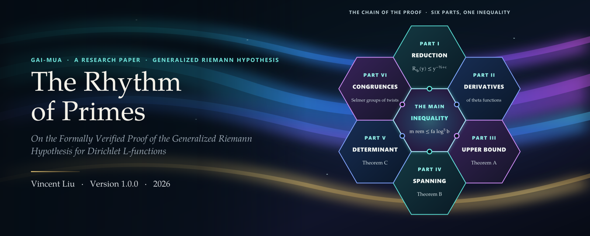

<p align="center">
  <a href="https://doi.org/10.5281/zenodo.24593828"></a>
</p>

<p align="center">
  <a href="https://doi.org/10.5281/zenodo.24593828"></a>
  <a href="LICENSE"></a>
  <a href="NOTICE"></a>
  
  
  
  <a href="https://orcid.org/0009-0000-8718-222X"></a>
</p>

<p align="center">
  <b><a href="paper/The-Rhythm-of-Primes.pdf">Read the paper</a></b> (3.4 MiB, 497 pages) ·
  <a href="https://doi.org/10.5281/zenodo.24593828">Zenodo</a> ·
  <a href="src/">LaTeX source</a> ·
  <a href="supplement/lean-anchors.md">Lean anchors</a> ·
  <a href="verification/">Record of the rebuild</a>
</p>

# The Rhythm of Primes

***On the Formally Verified Proof of the Generalized Riemann Hypothesis for Dirichlet L-functions***

Vincent Liu · [WiseMotif.ai](https://wisemotif.ai) · Version 1.0.0 · 27 November 2026 · doi:[10.5281/zenodo.24593828](https://doi.org/10.5281/zenodo.24593828)

A research paper of the GAI-MUA programme of WiseMotif.ai.

## Abstract

We give a complete account of a proof, due to L. Alpöge working with Claude, that no Dirichlet <i>L</i>-function vanishes in the half-plane Re <i>s</i> &gt; 1/2; in particular every nontrivial zero of the Riemann zeta function has real part 1/2. The proof was found and formalised in Lean 4; we follow the shorter formalisation `grh-lean`, which we rebuilt and checked, and each statement of the paper is tied to the Lean declarations that prove it. The argument is a descendant of Stepanov's method for curves over finite fields. A one-sided bound for a weighted sum of the von Mangoldt function over a residue class, whose weights 1 − χ<sub><i>K</i></sub>(<i>n</i>) come from an imaginary quadratic field, excludes zeros by Landau's theorem on Dirichlet integrals of one sign. The bound is proved by comparing two estimates for chains of <i>m</i> ≍ √<i>x</i> theta lifts between definite unitary groups over a CM field: an upper bound, in which the divisibility of derivatives of theta functions of CM elliptic curves at each prime reproduces the prime sums, and a lower bound from a product formula for Gram determinants, in which each prime reads the integral structure through its own twist and the norms of the lifts are Hecke <i>L</i>-values controlled by the Rallis inner product formula and by congruences, bounded through Selmer groups of anticyclotomic twists. A second-moment estimate shows that few translates of a Poincaré series span the space of target forms. The main term cancels between the two estimates, and the remainder is bounded by <i>x</i><sup>−1/2+ε</sup>.

## Attribution

The proof expounded here is due to Levent Alpöge, working with Claude. The Lean development `grh-lean`, on which the exposition is based, was produced at Anthropic in collaboration with Claude; it is Copyright 2026 Anthropic, PBC, and is distributed under the Apache License 2.0. Names of its declarations and short extracts of its statements are quoted under that licence. This paper claims no part of the proof.

## Status

The formal proof has been checked by the Lean kernel, again in the rebuild recorded in Appendix E, and, according to the authors of `grh-lean`, by independent proof checkers. This exposition has not been refereed; where it and the Lean development differ, the development is authoritative.

## The parts of the paper

The chain of the proof is set out in Section 2.1 of the paper (Figure 1, steps (S1)–(S8) and Table 1); the table below
is Table 1, with the sections of each part.

| Part | Title | Sections | Results | Used for |
|---|---|---|---|---|
| I | The reduction | §§4–9 | criterion, prime number theorem for the remainders, twisted lattices, data, main inequality | Theorems 1.1 and 1.2 |
| II | Derivatives of theta functions | §§10–14 | divisibility of derivatives of theta functions of CM curves, and its sharpness | sizes and divisibility in Theorems A and C |
| III | The upper bound: a composite lift | §§15–21 | spaces and chains, seesaw identity, divisibility and size of the composite lift | Theorem A; the spaces in Theorems B and C |
| IV | Spanning: a second moment | §§22–29 | equal multiplicities, unfolding, filling theorem, main and remaining terms | Theorem B |
| V | The lower bound: the determinant and one lift | §§30–36 | Rallis' formula, exchange identity, norm of the chain, auxiliary forms, cost of one lift | Theorem C |
| VI | The lower bound: congruences | §§37–45 | Galois representations of lifts, Ribet's method, denominators, Selmer data, twisting | regular families of twists in Theorem C |

Appendix A treats discrete series with a large gap (used in Parts IV and V); Appendix B states the background results
with their sources; Appendix C summarises, section by section, the Lean declarations that prove each statement (the
full table is [`supplement/lean-anchors.md`](supplement/lean-anchors.md)); Appendix D is the ledger of constants;
Appendix E is the record of the rebuild.

## The rebuild of the Lean development

The development [`grh-lean`](https://github.com/lsernau/grh-lean) was rebuilt for the paper with Lean 4.35.0
(commit `eb6cafb7290e8bd5f2937522d8d804f58f02bafc`) and Mathlib at commit `56a005855ea17e0b0958f73ec801ae140b0a1679`, and its environment replayed through the kernel
with `leanchecker --fresh Main` (exit 0). Each of the five main theorems

- `riemannHypothesis`
- `riemannZeta_eq_zero_re`
- `LFunction_ne_zero_of_half_lt_re`
- `LFunction_eq_zero_re`
- `LFunction_eq_zero_re_of_isPrimitive`

depends on the axioms `propext, Classical.choice, Quot.sound` only. The logs are in [`verification/`](verification/); the hashes of the Lean
sources used are in [`verification/statements.sha256`](verification/statements.sha256) and
[`verification/sources.sha256`](verification/sources.sha256); Appendix E of the paper describes the procedure.

## Contents of the repository

| Path | Contents |
|---|---|
| [`paper/The-Rhythm-of-Primes.pdf`](paper/The-Rhythm-of-Primes.pdf) | the paper, as deposited at Zenodo |
| [`src/`](src/) | the LaTeX source (pdfLaTeX; ASCII) |
| [`supplement/lean-anchors.md`](supplement/lean-anchors.md) | every numbered statement and anchored display, with its page and the Lean declarations that prove it |
| [`verification/`](verification/) | versions, build log, axioms, kernel replay, dependency cone, hashes of the Lean sources |
| [`ledger/`](ledger/) | the front matter, the bibliography with the records of its online check, the quotations and the constants checked against the Lean sources |
| [`SHA256SUMS`](SHA256SUMS) | SHA-256 of the PDF and of the two archives deposited at Zenodo |

## Building the PDF

The source compiles with pdfLaTeX alone (TeX Live 2025), with no script and no bibliography program:

```sh
cd src
pdflatex main.tex && pdflatex main.tex && pdflatex main.tex
```

The two files `main.lnk.prev` and `main.lnksum.prev` carry the table of Lean anchors of Appendix C from the build of
the deposited PDF; three passes give the same text as `paper/The-Rhythm-of-Primes.pdf`.

## Use of AI

WiseMotif.ai is an AI-native company, and its research and development are carried out with AI assistance throughout. The author designed the overall framework of the paper; AI tools assisted with the drafting and with the collation of the literature. The author has reviewed the entire text and is responsible for the whole of it.

## Citation

```bibtex
@misc{Liu2026Rhythm,
  author    = {Liu, Vincent},
  title     = {The Rhythm of Primes: On the Formally Verified Proof of the Generalized Riemann Hypothesis for Dirichlet $L$-functions},
  year      = {2026},
  version   = {1.0.0},
  publisher = {Zenodo},
  doi       = {10.5281/zenodo.24593828},
  url       = {https://doi.org/10.5281/zenodo.24593828}
}
```

## Related work

The paper belongs to the same line of research as the monograph *Arithmetic Spectral Descent* (Series 03 of the
Grothendieckian Programme, doi:[10.5281/zenodo.23564898](https://doi.org/10.5281/zenodo.23564898)), which studies the Riemann
Hypothesis and GRH.

## Licence

The paper and this repository are distributed under the Creative Commons Attribution 4.0 International licence
([`LICENSE`](LICENSE)). Names of declarations of `grh-lean` and short extracts of its statements, Copyright 2026
Anthropic, PBC, are quoted under the Apache License 2.0 ([`LICENSE-APACHE`](LICENSE-APACHE), [`NOTICE`](NOTICE)).

---

<sub>Vincent Liu · <a href="https://wisemotif.ai">WiseMotif.ai</a> · ORCID <a href="https://orcid.org/0009-0000-8718-222X">0009-0000-8718-222X</a></sub>
